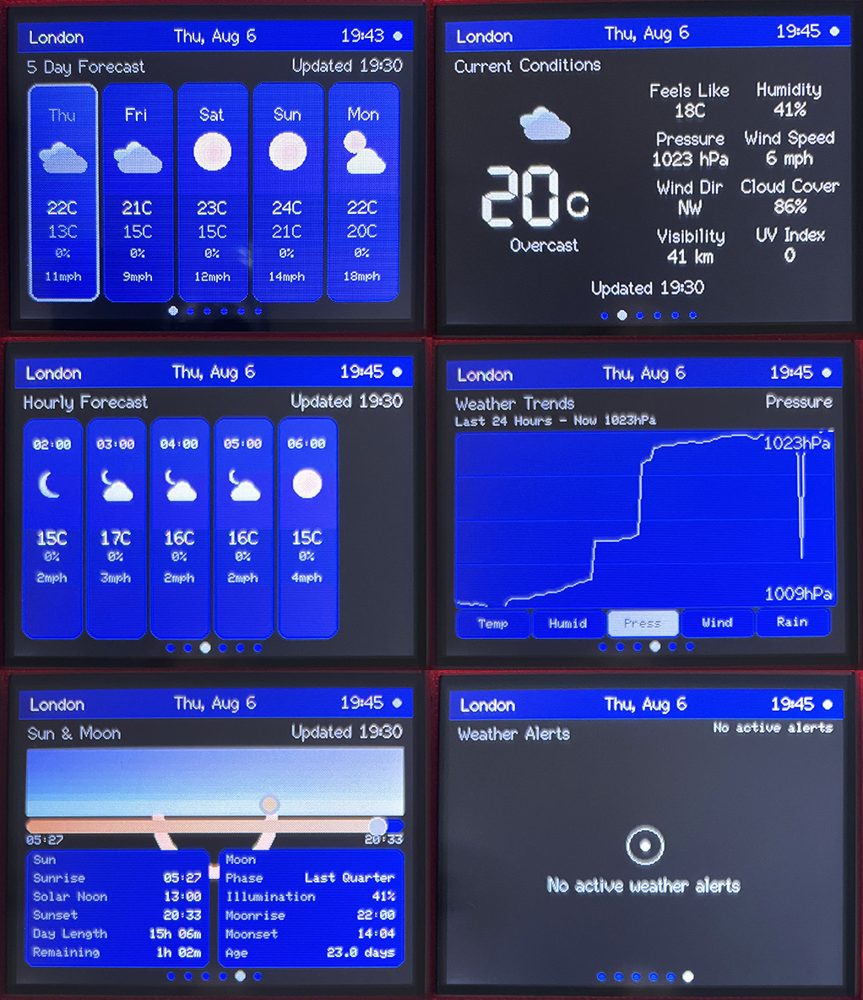

# CYD Weather

> Forked from [HenrysCat/CYD-Weather-Dashboard](https://github.com/HenrysCat/CYD-Weather-Dashboard) — all credit for the original design and implementation goes there. This fork carries a local fix and WiFi-provisioning tweak on top.

Firmware for the **ESP32-2432S028R** ("Cheap Yellow Display") — a cheap,
widely available ESP32 board with a built-in 2.8" touchscreen. Turns it into
a standalone weather station, no separate hardware needed.

A self-hosted weather station dashboard: live conditions and forecasts from
your choice of 20 weather data providers, on-device history logging and
trend graphs, sunrise/sunset and moon phase, configurable alerts, and a
built-in web portal for setup — no companion app or cloud account required.



**[Flash it in your browser with the Web Flasher](https://henryscat.github.io/)**

<sub>Hardware: ESP32-WROOM-32, 2.8" ILI9341 320x240 TFT, XPT2046 resistive
touch. Software: Arduino framework + TFT_eSPI (no LVGL), modular C++, fully
non-blocking main loop.</sub>

## Dashboard pages

Swipe (or wait for auto-rotation) to move between pages; tap a 5-Day card to
drill into that day's hourly detail. A persistent status bar (location, date,
time, network indicator) sits above every page and doubles as the weather
alert banner when one is active.

| # | Page | Notes |
|---|---|---|
| 1 | **5 Day Forecast** | Default boot page. Tap a day to open its hourly drill-down. |
| 2 | **Current Conditions** | Hero temperature, 8-stat grid (feels-like, humidity, pressure, wind, cloud cover, visibility, UV). |
| 3 | **Hourly Forecast** | Card timeline, auto-shifts forward one hour every few seconds. |
| 4 | **Weather Trends** | Line graphs (temp/humidity/pressure/wind/rain) from the on-device history log — no network request. |
| 5 | **Sun & Moon** | Sunrise/sunset from the weather provider; moon phase, moonrise/moonset computed on-device. |
| 6 | **Weather Alerts** | Active/recent alerts (high wind, heavy rain, heat/cold, rapid pressure change, high UV); also banners in the status bar on any page. |
| — | **Day Hourly** (drill-down) | Reached by tapping a 5-Day Forecast card; not part of the rotation. |
| — | **Setup** | Shown automatically in AP/recovery mode; also reachable manually. |
| — | **System Info** | Device/network diagnostics; reached via the physical **BOOT** button, off the normal rotation. |

The first three live pages, Sun & Moon, and Weather Alerts all share one
Open-Meteo-style HTTP request per refresh cycle (default every 15 minutes),
fetched on a background FreeRTOS task so the UI never stalls. See
[src/weather/README.md](src/weather/README.md) for the data-layer details.

## Weather data providers

Selectable from the web portal, no rebuild required — 20 options in total:

- **Open-Meteo** — Auto (best-match blend) or pinned to a specific national
  model: UK Met Office (UKMO), DWD (Germany), NOAA GFS (USA), Météo-France,
  ECMWF, KMA (South Korea), JMA (Japan), MeteoSwiss, MET Norway, GEM (Canada),
  BOM (Australia), CMA (China), KNMI (Netherlands), DMI (Denmark),
  ItaliaMeteo, GeoSphere (Austria) — all keyless.
- **MET Norway** (api.met.no) — direct integration, keyless.
- **Met Office Weather DataHub** ("Global Spot") — requires an API key.
- **Pirate Weather** — Dark Sky-compatible, requires an API key.

## Building

Requires [PlatformIO](https://platformio.org/). TFT_eSPI is configured entirely
from build flags in [platformio.ini](platformio.ini) — no library edits needed.

```
pio run                 # build
pio run -t upload       # flash
pio device monitor      # 115200 baud, exception decoder enabled
```

There is no OTA update mechanism — the board's default dual-app A/B
partition table has been replaced with a single-app layout
([partitions.csv](partitions.csv)) to reclaim the unused second app slot for
flash headroom. Re-flashing preserves NVS settings/WiFi credentials but
resets the on-device weather history log (its LittleFS partition
moves/resizes).

## First boot

With no WiFi credentials stored, the device starts a setup AP:

- SSID `CYD-xxxx` (chip-id suffix), password `cyd-setup`
- Browse to `http://192.168.4.1`, enter your WiFi credentials, save.

Once connected it serves the same portal at `http://cyd-weather.local`
(mDNS) or its DHCP address (shown in the status bar / System Info page).
Moving the device to a new network later works the same way: after 3 failed
connection attempts it automatically falls back to the setup AP.

## Web API

| Endpoint | Method | Purpose |
|---|---|---|
| `/` | GET | Settings portal (served from flash) |
| `/api/status` | GET | Version, uptime, heap, WiFi state |
| `/api/settings` | GET | Current settings (WiFi password masked) |
| `/api/settings` | POST | Partial update (JSON); applied live |
| `/api/restart` | POST | Deferred restart |
| `/api/settings/backup` | GET | Full settings as a downloadable JSON file (secrets unmasked) |
| `/api/settings/restore` | POST | Apply a backup JSON body; deferred restart |
| `/api/sdcard/status` | GET | `{"present": bool}` |
| `/api/sdcard/backup` | POST | Write the same backup JSON to the SD card |
| `/api/sdcard/restore` | POST | Read it back from the SD card and apply |

Settings cover WiFi/hostname, location & timezone, units, weather provider
and API key, refresh interval, display (brightness, rotation, color order),
touch calibration, and NTP server — all changed live, no reflash needed.

Factory reset is physical-only: hold the BOOT button for 10 seconds to wipe
settings and reboot.

The web UI's Backup & Restore card can save/load the full settings file
(WiFi password and API keys included, unmasked) either as a browser download
or, if a microSD card is present in the slot, directly to/from it.

## Project layout

```
src/
  config/    Version.h, AppConfig.h — every pin/timeout/default lives here
  display/   DisplayManager (TFT, backlight PWM, sprite canvas), TouchManager
  network/   NetworkManager — non-blocking WiFi state machine, AP fallback, mDNS
             TimeManager — SNTP sync, DST-aware wall clock
  pages/     Page base class, PageManager, the dashboard pages, SetupPage, SystemPage
  storage/   SettingsManager (versioned NVS blob) + WeatherHistoryManager (LittleFS CSV log)
  ui/        Theme, StatusBar, shared widgets/layout, WeatherIconTheme + WeatherIconBitmaps (icon art),
             AlertTheme, Graph (reusable line-graph component)
  utils/     Log, TaskScheduler, Format
  weather/   WeatherService (fetch, multi-provider), WeatherIcons (condition/icon engine),
             WeatherAlertManager, WeatherUnits, WeatherData
  web/       WebPortal + PROGMEM portal page
```

## Architecture notes

- **Non-blocking main loop** — `loop()` only runs the cooperative
  `TaskScheduler`; no `delay()` anywhere. Tasks exceeding their time budget
  are logged.
- **Double buffering where practical** — dynamic regions render into one
  shared 16-bit sprite (bounded by `cfg::display::CANVAS_MAX_BYTES`, default
  52 KB) and are pushed flicker-free; a full-screen buffer (150 KB) would not
  fit ESP32 heap. If the sprite allocation ever fails, rendering degrades to
  direct drawing.
- **Dirty-flag rendering** — data updates (1 Hz) and painting (max 20 fps)
  are decoupled; idle render passes cost microseconds.
- **Backlight-fade page transitions** — swapping pages ramps the backlight
  down then back up across the swap so the redraw underneath is never
  visible.
- **Settings** — one versioned NVS blob; compile-time defaults in
  `AppConfig.h`; changed live via the web portal, migrated forward across
  firmware updates.
- **Auto-dim** — backlight dims after a configurable idle timeout; the touch
  that wakes it is consumed.

## CYD pin reference

| Function | GPIO |
|---|---|
| TFT SPI (HSPI) MISO/MOSI/SCLK/CS/DC | 12 / 13 / 14 / 15 / 2 |
| TFT backlight (LEDC PWM) | 21 |
| Touch SPI (VSPI) CLK/MISO/MOSI/CS/IRQ | 25 / 39 / 32 / 33 / 36 |
| SD card SPI (VSPI, shared with touch — see [SdCardManager.h](src/storage/SdCardManager.h)) SCK/MISO/MOSI/CS | 18 / 19 / 23 / 5 |
| BOOT button (tap: System Info page; hold 10s: factory reset) | 0 |
| RGB LED (unused, active low) | 4 / 16 / 17 |
| LDR light sensor (unused) | 34 |

## Roadmap

- Weather Trends: 7-day / 30-day views (currently 24h only — the log already
  stores enough for both; would need a coarser point-decimation step since
  `WeatherTrendsPage::kMaxPoints` is sized for 24h at the log's 15-min floor)
- Touch calibration page (values already persisted & settable via API)
- Auto-brightness from the LDR; status LED as network indicator
- Weather alert thresholds are configurable in `AppSettings` but not yet
  exposed in the web portal UI
